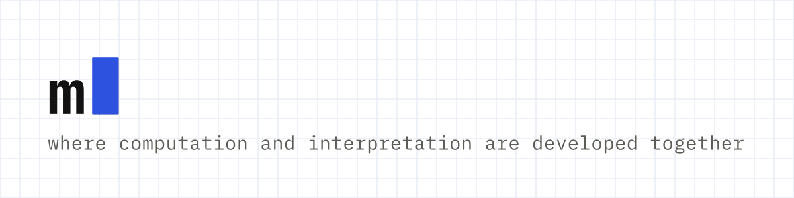

  

# Methods Lab

The Methods Lab is a lab for digital, computational, AI and qualitative methods in Digital Humanities and interdisciplinary research. Based in the Department of Digital Humanities at King’s College London, it welcomes experimentation, with a focus on developing methods and tools.

The Lab brings together expertise across the department and provides a space for critical dialogue and collaboration with researchers and practitioners nationally and internationally. Through these connections, it supports the exchange of methodological approaches, the testing and co-development of tools, the sharing of teaching resources and the development of joint funding proposals.

**Website:** [jannajoceli.github.io/methods-lab](https://jannajoceli.github.io/methods-lab/)

## Co-leads

- [Dr Janna Joceli Omena](https://www.kcl.ac.uk/people/janna-joceli-omena), Lecturer in Digital Methods · J.J.Omena@kcl.ac.uk
- [Dr Mark J. Hill](https://www.kcl.ac.uk/people/mark-j.-hill), Lecturer in Cultural Computation · mark.j.hill@kcl.ac.uk

Department of Digital Humanities · Faculty of Arts & Humanities · King’s College London
